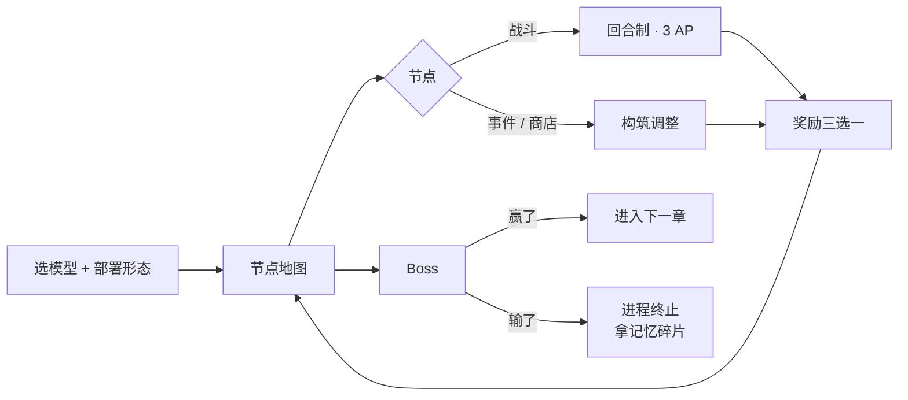

# 游戏概览 · 队友版

> 5 分钟看完。细节在《三、设定扩展》和《四、玩法设计》——那两份是给设计用的，这份是给人看的。

---

## 30 秒版

> 你是计算机世界里的一个 **agent**。
> 每回合 **3 个行动点**，用**一种语言**、配**一把引擎**、驱动**一堆算法**，一层层往上打。
> 死了不是重来，是「**进程终止 → 从备份恢复**」。

三根支柱：

| 支柱 | 一句话 | 玩家该有的反应 |
|---|---|---|
| 取舍感 | 3 个点永远不够花 | "打还是走？" |
| 构筑感 | 语言 × 引擎 × 算法 三层相乘 | "我这套能成" |
| 本体感 | 你只有一个身体 | "我快崩了" |

---

## 1. 一局在玩什么

- 一局 = **一个 Sprint**，3 章 × 7 节点，25~40 分钟。
- 第一个 Boss 在 **8~12 分钟** 出现。
- 死了 → 拿"记忆碎片" → 回城解锁新玩法，再来。

---

## 2. 世界：六层，往上爬

| 层 | 长什么样 | 特色规则 |
|---|---|---|
| 硬件层 | 电路板、焊点 | 内存板少 1 行，但技能冷却 -1 |
| 内核层 | 深蓝迷宫、进程表 | 每回合 AP +1，但随机一个技能进冷却 |
| 运行时层 | 垃圾堆、回收站 | 垃圾生成 ×2 |
| 应用层 | 写字楼、便利贴 | 敌人每 3 回合换目标 |
| 网络层 | 深海、光缆 | 射程 +1，命中 -10% |
| 云端 | 天空城 | 内存板可扩容，但每回合掉血 |

---

## 3. 你是谁：四层身份

| 层 | 是什么 | 什么时候定 | 影响 |
|---|---|---|---|
| **阵营（部署形态）** | 你跑在哪 | 开局选 1 个 | 全局规则（云端 / 本地 / 端侧 / 开源权重 / 私有化） |
| **公司 + 模型** | 你是谁 | 开局选 1 个模型 | 1 个被动 + 语言亲和 |
| **语言** | 你的身份 | 开局定，**本体只有 1 种** | 伤害倍率 + 独有被动 |
| **引擎** | 你的武器 | 全程换 | 攻击形态（点杀 / 范围 / 穿透 / 召唤……） |
| **算法** | 你的技能 | 全程捡 | 具体效果，占内存格 |

**一句话记住**：阵营是你在哪跑，模型是你自己，语言是性格，引擎是枪，算法是子弹。

> 可选模型：**DeepQuest-R1 / Claudia / Omni / GML / Gemina / Alpaca / Wanwen / Kiki**。
> 这些都是**致敬式化名**（真名对照见《三、设定扩展》2.3）——玩家一眼看得出在指谁，但我们不用打官司。
> 每个被动都来自它的真实特点：DeepQuest 会思考很久（能存 AP），Claudia 记性最好（内存板更高），Kiki 记得最多但身子最虚。

### 语言（首发只做 4 种）

| 语言 | 性格 | 一句话机制 |
|---|---|---|
| **C** | 暴力 | 伤害 ×1.3，但 5% 概率自伤 |
| **Python** | 灵活 | 每次攻击追加 1 点真伤，但基础 ×0.85 |
| **Rust** | 稳重 | 免疫"内存泄漏/越界"类负面，但每回合最多 2 个技能 |
| **JS** | 混乱 | 可改伤害类型，30% 概率 ×2 或 ×0.5 |

### 引擎（首发 3 把）

| 引擎 | 形态 | 特点 |
|---|---|---|
| Godot | 快速连射 | 轻，便宜，伤害低 |
| Unreal | 重型炮击 | 重，贵，击退 + 破甲 |
| 自研引擎 | 可成长 | 每场战斗 +1 伤害，越打越强 |

---

## 4. 一回合 = 全部玩法

**你每回合有 3 个 AP。**

| 动作 | AP |
|---|---|
| 走 1 格 | 1 |
| 放技能（轻） | 1 |
| 放技能（重，O(n log n) 以上） | 2 |
| 引擎普攻 | 1~3（看引擎） |
| 部署分身 | 2 |
| 命令分身多动一次 | 1 |
| **「编译」：让一个技能冷却 -1** | 1 |
| 防御（受伤 -50%） | 1 |
| **维持一个后台进程** | 每回合 1（自动扣） |

> **"后台开太多，前台就卡"**——挂 2 个进程，你就只剩 1 AP。

### 举个真例子（第 3 回合）

场上：你（C，Godot，HP 30）、分身（Rust，自动）、敌人 3 只。

| 敌人 | 意图 |
|---|---|
| Bug（8 HP） | 打你 |
| 内存泄漏怪（14 HP） | 拆你 1 格内存 |
| 死循环（20 HP） | **本回合回满血** |

**错的打法**：3 点全打死循环 → 打 18，它剩 2，然后回满。白打。

**对的打法**：
1. 剪枝（1 AP）→ 打断它回血
2. 快速排序（1 AP）→ 同行各 6 伤，Bug 死
3. 走 1 格（1 AP）→ 拉开距离

> 这一回合同时教了三件事：**有些怪不能靠伤害解决 / 范围比对单点划算 / 走位也是输出。**

---

## 5. 分身：你唯一能"换语言"的方式

- 部署 **2 AP**，之后**自己动**，你不能替它走位。
- 花 **1 AP** 可以催它多动一次（每回合一次）。
- 部署时选行为：`打最近的` / `保护我` / `守路口`。
- 死了你会掉 15% 血 + 1 回合"内存碎片化"，但会**愤怒**（攻击 +20%，2 回合）。

| 类型 | 语言 | 成本 | 用处 |
|---|---|---|---|
| 单语言分身 | 跟你一样 | 2 AP + 2 格 | 就是"输出不够" |
| 多语言分身 | 跟你不一样 | 2 AP + 4 格 | **带来第二种语言的被动**，补你的短板 |

> 你本人只专精一种语言（有身份感），第二种语言靠"养分身"获得。

---

## 6. 内存板：本作的招牌

**5×5 的格子，所有东西都要装进去。**

1. 技能、引擎、分身、进程都占格（1 格 ~ 2×2）。
2. **必须连续放置**（横或竖），模拟真实 `malloc`。
3. 卸下东西会留空洞 → **碎片化**，大技能就塞不进去了。
4. 可以"整理内存"，但要花 1 AP / 一次行动。

> **复杂度 = 价格**：
> 时间复杂度 → 冷却回合数；空间复杂度 → 占几格。
> O(n²) 的技能冷却 3、占 4 格。**知识变成了数值。**

---

## 7. 肉鸽层：三层味道

| 系统 | 是什么 | 例子 |
|---|---|---|
| **技术债** | 主动接受负面，换强力 | "硬编码"：一个技能 +50% 伤害，但永远不能升级 |
| **许可证** | 遗物，用开源协议命名 | MIT：所有技能冷却 -1；GPL：技能 +30%，但敌人会偷学 |
| **三选一** | 奖励互相排斥 | 给了"AP +1"就不给"新技能" |

**元进度只解锁玩法，不解锁数值**：新模型、新语言、新阵营、新事件。
**永远不做"碎片买 +5% 攻击力"**——那会让"这局输了"变得无所谓。

---

## 8. "这是编程"体现在哪（挑 8 个做就够）

1. **复杂度 = 费用**（O(n²) 又贵又占地方）
2. **内存板**：连续分配、碎片、整理
3. **「编译」动作**：花 1 AP 等冷却
4. **分身 = fork 出来的子进程**，自己跑
5. **编译台 = 3 选 1 + 引入 Bug**
6. **exploit**：把 Bug 变成武器
7. **终端日志**：每次行动打一行 `exec quick_sort --lang=C`
8. **蒙特卡洛预演**：战前点一下，模拟 1000 次，显示胜率

---

## 9. 第一版只做这些

**目标：证明"3 个 AP 怎么花"好玩。**

- ✅ 1 个 agent，2 种语言（C + Rust）
- ✅ 2 把引擎（Godot / Unreal）
- ✅ 6 个技能（单体 / 范围 / 位移 / 控制 / 被动 / 大招）
- ✅ 3 个敌人 + 1 个 Boss（死锁）
- ✅ 5×5 内存板 + AP + 冷却 + 敌人意图
- ✅ 终端日志
- ❌ **不做**：分身、编译台、地图、阵营、事件、元进度

**通过标准**：一个没看过设定的人，10 分钟内能说出"我这回合为什么这么打"。

---

## 10. 术语速查

| 词 | 一句话 |
|---|---|
| Agent | 你，有血有内存的单位 |
| AP | 每回合 3 点，干什么都要花 |
| 语言 | 你的伤害性格，本体只有 1 种 |
| 引擎 | 你的攻击形态 |
| 算法 | 你的技能，占内存格 |
| 内存板 | 5×5 装载空间，连续分配 |
| 进程 | 后台持续效果，每回合吃 1 AP |
| 分身 | fork 出来的自动单位 |
| 技术债 | 主动接受的负面，换强力 |
| 编译 | 花 1 AP 让技能冷却 -1，或升级技能（有概率出 Bug） |

---

## 11. 三条铁律（吵架时拿这个裁决）

1. **AP 不许加。** 爽感靠被动和组合，不靠堆行动点。加了 AP，所有数值全部作废。
2. **每个技能必须有一个"打不了"的场景。** 能通吃的技能是设计事故。
3. **宏循环只解锁玩法，不解锁数值。** 一旦能"刷数值"，肉鸽就死了。
